# MatchDay Ready — Club-Wide Edition (v2.0) Release Notes & Milestone Breakdown

**Live Production URL:** [https://matchday-ready.web.app](https://matchday-ready.web.app)  
**GitHub Repository:** [https://github.com/neildrosario/MatchDay-Ready](https://github.com/neildrosario/MatchDay-Ready)  
**Default Club Seed:** Straffan Association Football Club (`straffan_afc`)  
**Default Club Admin & Teams:** Neil D'Rosario (`U10 White` & `U10 Green`)

---

## Executive Summary

**MatchDay Ready v2.0 (Club-Wide Edition)** transforms the original single-file beta prototype ([legacy-prototype.html](file:///home/neildrosario/MatchDay-Ready/legacy-prototype.html)) into a scalable, multi-tenant cloud application built on **Vite**, **Tailwind CSS**, and **Firebase v10 (Authentication, Cloud Firestore & Hosting)**. It supports 30+ coaches across an entire club pathway—from **U7 Mini-Soccer (`5v5`, `6v6`, `7v7`)** to **Youth & Senior (`9v9`, `11v11`)**—with real-time co-coach sync, shared age-group player pools, automated squad splitting, tactical formation remapping, and a pocket-safe sideline match clock.

```mermaid
flowchart LR
    M1["M1: Vite + Firebase Foundation"] --> M2["M2: Coach Auth & RBAC"]
    M2 --> M3["M3: Real-Time Firestore & Conflict Detection"]
    M3 --> M4["M4: Core Pitch, 50/50 Swaps & Stats"]
    M4 --> M5["M5: Admin Coach Panel, Bulk Paste & Live Hosting"]
    M5 --> M6["M6: 5v5–11v11 (25 Formations) & Mini-Pitch Export"]
    M6 --> M7["M7: Halves/Thirds/Quarters & Specialist GK Tags"]
    M7 --> M8["M8: 25-Kid → 3-Team Matchday Squad Splitter"]
    M8 --> M9["M9: Pocket-Safe Sideline Timer & 50% Sub Alerts"]
```

---

## Detailed Breakdown by Milestone

### Milestone 1: Project Scaffolding & Firebase Foundation
* **Files:** [package.json](file:///home/neildrosario/MatchDay-Ready/package.json), [vite.config.js](file:///home/neildrosario/MatchDay-Ready/vite.config.js), [src/firebase.js](file:///home/neildrosario/MatchDay-Ready/src/firebase.js), [firebase.json](file:///home/neildrosario/MatchDay-Ready/firebase.json), [firestore.rules](file:///home/neildrosario/MatchDay-Ready/firestore.rules), [firestore.indexes.json](file:///home/neildrosario/MatchDay-Ready/firestore.indexes.json)
* **What Was Built:**
  * Preserved the original Netlify single-file prototype as [legacy-prototype.html](file:///home/neildrosario/MatchDay-Ready/legacy-prototype.html) and migrated to a modular ES6 architecture with Vite + Tailwind CSS + Firebase v10.
  * Configured Cloud Firestore with **IndexedDB offline persistence (`persistentLocalCache`)** so sideline updates work instantaneously even on pitches with poor mobile signal.
  * Hardened multi-tenant Firestore Security Rules ([firestore.rules](file:///home/neildrosario/MatchDay-Ready/firestore.rules)) enforcing club membership and team assignment checks across `clubs`, `teams`, `users`, `players`, `matches`, and `lineups`.

---

### Milestone 2: Authentication, Role-Based Access Control (RBAC) & Team Selector
* **Files:** [src/auth.js](file:///home/neildrosario/MatchDay-Ready/src/auth.js), [index.html](file:///home/neildrosario/MatchDay-Ready/index.html)
* **What Was Built:**
  * **Coach Authentication Modal:** Supports **Email/Password Sign-In & Registration** and **Google Sign-In** with `onAuthStateChanged` session persistence, plus a **Local Club Mode** fallback for offline testing.
  * **Automatic First-Login Club Seeding:** Seeds **Straffan AFC (`straffan_afc`)** with **Neil D'Rosario** as Club Admin (`ADMIN`) managing **🛡️ U10 White (U10)** and **🛡️ U10 Green (U10)**.
  * **Header Team Switcher:** Allows coaches and managers assigned to multiple squads to switch teams with one tap in the top bar.

---

### Milestone 3: Real-Time Firestore Data Layer & Shared Roster Conflict Detection
* **Files:** [src/db.js](file:///home/neildrosario/MatchDay-Ready/src/db.js), [src/pitch.js](file:///home/neildrosario/MatchDay-Ready/src/pitch.js)
* **What Was Built:**
  * **Real-Time Co-Coach Sync (`onSnapshot`):** Changes made by one coach on a match or lineup immediately appear on their co-coach's phone.
  * **Shared Age-Group Player Pool (`allowedTeamIds`):** Players belong to a primary team (`primaryTeamId`) but can be shared across sibling teams in the same age group (`🔗Manage Shared Age-Group Player Pool`).
  * **Live Conflict Warning Banner:** Automatically detects if a shared player is selected on two different club teams on the same date and period, displaying a non-blocking alert: `⚠️ [Player] is also assigned to [Other Team] (Pos) in Q1`.

---

### Milestone 4: Core Sideline Features, Accurate 50/50 Swap Accounting & Beta Importer
* **Files:** [src/pitch.js](file:///home/neildrosario/MatchDay-Ready/src/pitch.js), [src/stats.js](file:///home/neildrosario/MatchDay-Ready/src/stats.js), [src/export.js](file:///home/neildrosario/MatchDay-Ready/src/export.js)
* **What Was Built:**
  * Retained all core sideline tools: fractional period lengths (e.g., `12.5m`), **🪄 Auto-Fair Squad** rotation, **🔄 Mid-Period Swap** modal, **🚫 Unavailable / Resting This Week** checkboxes, and **Copy Prev Period**.
  * **Upgraded 50/50 Swap Minute Calculation:** Credits **both** the incoming substitute and the outgoing player with 50% of the period's minutes in that positional group (`GK`, `DEF`, `MID`, `ATT`).
  * **📥 Legacy Beta Data Importer:** One-click migration button to import existing `uFootballAppV7` data from browser `localStorage` into the selected Firestore team.

---

### Milestone 5 (5A, 5B & 5C): Admin Coach Management, Bulk Roster Paste & Live Cloud Hosting
* **Files:** [src/db.js](file:///home/neildrosario/MatchDay-Ready/src/db.js), [src/stats.js](file:///home/neildrosario/MatchDay-Ready/src/stats.js), [.github/workflows/firebase-hosting.yml](file:///home/neildrosario/MatchDay-Ready/.github/workflows/firebase-hosting.yml)
* **What Was Built:**
  * **Milestone 5A (Cloud Deployment & CI/CD):** Pushed full repository to GitHub (`neildrosario/MatchDay-Ready`) and deployed live to **[https://matchday-ready.web.app](https://matchday-ready.web.app)**.
  * **Milestone 5B (👥 Admin: Manage Coaches & Team Access):** Allows Club Admins to pre-authorize coaches by email, assign/unassign specific teams via 1-tap toggle pills (`✓ U10 White`, `+ U10 Green`), and set roles (`ADMIN`, `COACH`, `VIEWER`) directly from the app UI.
  * **Milestone 5C (📋 Bulk Paste Squad List & 🧹 Clear Team Players):** Allows coaches to wipe sample player names in one click and paste an entire squad list from WhatsApp or Excel (automatically stripping numbering like `1.`, `2)`).

---

### Milestone 6: Full Format Expansion (`5v5`–`11v11`), 25 Tactical Formations & Visual Mini-Pitch Export
* **Files:** [src/db.js](file:///home/neildrosario/MatchDay-Ready/src/db.js), [src/pitch.js](file:///home/neildrosario/MatchDay-Ready/src/pitch.js), [src/export.js](file:///home/neildrosario/MatchDay-Ready/src/export.js)
* **What Was Built:**
  * **5 Game Formats & 25 Tactical Shapes:**
    * **5v5:** `GK-2-2`, `GK-1-2-1`, `GK-1-3`, `GK-3-1`
    * **6v6:** `GK-2-2-1`, `GK-3-1-1`, `GK-2-1-2`, `GK-1-3-1`
    * **7v7:** `GK-2-3-1`, `GK-3-2-1`, `GK-2-1-3`, `GK-2-2-2`, `GK-3-1-2`
    * **9v9:** `GK-3-3-2`, `GK-3-2-3`, `GK-3-4-1`, `GK-2-4-2`, `GK-4-3-1`, `GK-2-3-3`
    * **11v11:** `GK-4-3-3`, `GK-4-4-2`, `GK-4-2-3-1`, `GK-3-5-2`, `GK-3-4-3`, `GK-5-3-2`
  * **Per-Period Tactical Shape Selector & Smart Player Remapper:** Coaches can change formation for a specific period (e.g. switching from `GK-2-3-1` in Q1 to `GK-3-2-1` in Q3) without losing players already on the pitch, or click **Apply Q1–Q4** to apply a shape across the entire match.
  * **Visual Mini-Pitch PNG Export (`📸 Share Sheet`):** Each period card on the exported team sheet image renders its `📐 Formation` badge and a visual mini tactical pitch showing the exact formation lines (`ATT`, `MID`, `DEF`, `GK`) for that period.

---

### Milestone 7: Older Age-Group Essentials (`2 Halves` / `3 Thirds` / `4 Quarters` & Specialist `🧤 GK` / Position Tags)
* **Files:** [src/db.js](file:///home/neildrosario/MatchDay-Ready/src/db.js), [src/pitch.js](file:///home/neildrosario/MatchDay-Ready/src/pitch.js), [src/stats.js](file:///home/neildrosario/MatchDay-Ready/src/stats.js), [src/export.js](file:///home/neildrosario/MatchDay-Ready/src/export.js)
* **What Was Built:**
  * **Period Mode Selector (`4 Qtrs` | `3 Thirds` | `2 Halves`):** Adapts the pitch tabs (`Q1–Q4`, `T1–T3`, `H1–H2`), stats engine, and PNG export to match youth/senior league rules.
  * **Specialist `🧤 GK` & Preferred Zone Tags (`🔄 Any`, `🧤 GK`, `🛡️ DEF`, `⚙️ MID`, `⚡ ATT`):** Coaches can tag specialist goalkeepers and preferred outfield roles in **📊 Squad & Stats**. **🪄 Auto-Fair Squad** automatically keeps specialist GKs in goal (when tagged) and prioritizes preferred zones while still ensuring fair total playing time across the squad.

---

### Milestone 8: Age-Group "Matchday Squad Splitter" (25 Kids $\rightarrow$ 3 Teams Workflow)
* **Files:** [src/splitter.js](file:///home/neildrosario/MatchDay-Ready/src/splitter.js), [src/db.js](file:///home/neildrosario/MatchDay-Ready/src/db.js), [index.html](file:///home/neildrosario/MatchDay-Ready/index.html)
* **What Was Built:**
  * **Dedicated `📋 Squad Splitter` Tab:** Built for Lead Managers managing large age-group pools (e.g., 25 kids split across `White`, `Green`, and `Blue` with 3 matchday coaches).
  * **1-Tap Attendance & `🪄 Auto-Split Evenly`:** Mark absentees as `🚫 Off`, then tap team pills or click **🪄 Auto-Split Evenly** to distribute available players evenly across all sibling teams while balancing `🧤 GK`, `DEF`, `MID`, and `ATT` roles first.
  * **`🚀 Publish Squads to Coaches` & `📋 WhatsApp` Summary:** Locks in each team's matchday roster for that date, pre-generates fair starting lineups across all periods for all teams, and copies a formatted WhatsApp squad announcement to the clipboard.

---

### Milestone 9: Live Sideline Match Timer & 50% Mid-Period Sub Alert Bar
* **Files:** [src/timer.js](file:///home/neildrosario/MatchDay-Ready/src/timer.js), [index.html](file:///home/neildrosario/MatchDay-Ready/index.html)
* **What Was Built:**
  * **Pocket-Safe Wall-Clock Timer:** Anchored to `Date.now()` timestamps per match and period so locking a phone screen in a coach's pocket never causes timer drift.
  * **50% Mid-Period Sub Window Alert:** Flashes an amber alert banner (`🔔 50% Mid-Q1 Sub Window Due!`), triggers haptic vibration + audio chime, and provides a 1-tap **`🔄 Make Sub`** button to open the Mid-Period Swap modal.
  * **Full-Time Alert & Period Advancement:** Signals full time with a 1-tap **`⏭️ Go to Next Period`** button.
